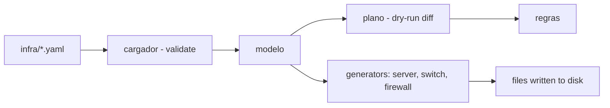

# infra-as-code-lab

**English** · [Português (Brasil)](README.md)

[](#) [](#) [](#) [](#.github/workflows/ci.yml) [](LICENSE)

## What it is

An **Infrastructure as Code (IaC)** lab that reads declarative infrastructure in YAML (servers, network devices, access, firewall) and produces **deterministic plans and diffs** in an **idempotent** way — inspired by Terraform's `plan`/`dry-run`. It does not apply anything to real equipment (simulation/file generation only). It is an educational IaC/idempotency lab.

## Status

An educational IaC lab, working and tested (121 tests).

## Features

- **Declarative model**: infrastructure in YAML (`infra/servidores.yaml`, `rede.yaml`, `acessos.yaml`) with normalized and validated keys (`cargador.py`).
- **`plano`** (default): shows the **diff** of what would change, writing nothing — `--dry-run` by principle.
- **`gerar`**: writes the generated files to disk (with an option not to write).
- **`regras`**: shows the applied rules/states.
- **Idempotency**: same inputs → same plan; stable diff (fixed date so the diff does not break).
- **Per-type generators**: `servidor`, `switch`, `firewall`, plus `ap` and `base`.

## Architecture

An `iaclab` package: `cargador` (YAML parse/validation), `modelo` (data), `diff`/`plano` (state comparison), `geradores/*` (produce output), `render` and `cli`. Three base states (desired/current/output) ensure idempotency.



## Stack

- Python ≥ 3.10
- PyYAML ≥ 6.0 (only dependency)
- pytest (dev)
- CI: GitHub Actions (windows-latest, Python 3.11)

## Repository layout

```
infra-as-code-lab/
├── pyproject.toml · requirements.txt
├── infra/
│   ├── servidores.yaml · rede.yaml · acessos.yaml
├── src/iaclab/
│   ├── cargador.py · modelo.py · diff.py · plano.py
│   ├── render.py · cli.py
│   └── geradores/     # ap, base, firewall, servidor, switch
├── docs/              # declarative model, why dry-run matters
├── exemplos/          # execution plan
├── tests/             # 121 tests
└── LICENSE            # MIT
```

## Prerequisites and installation

Python ≥ 3.10.

```bash
pip install -e .
```

## How to run

```bash
# shows the diff of what would change, writing nothing (dry-run by default)
iaclab plano --infra infra/servidores.yaml --infra infra/rede.yaml --infra infra/acessos.yaml

# generates the files to disk
iaclab gerar --infra infra/servidores.yaml --infra infra/rede.yaml --saida saida

# shows the rules/states
iaclab regras
```

## Tests and quality

Real command (verified by the agent):

```bash
python -m pytest tests/
# 121 passed
```

- CI (`ci.yml`, windows-latest, Python 3.11): checks encoding, imports the package, runs the suite.

## Technical decisions and trade-offs

- **`plano`/`dry-run` as the default**: nothing is written without an explicit step, mirroring Terraform's `plan`; the cost is one extra step to apply.
- **Declarative YAML with key validation**: catches errors early instead of later drift.
- **Fixed reference date in the output**: keeps the diff deterministic and comparable across runs.

## Known limitations and roadmap

- It does not apply to real equipment (simulation/file generation only).
- The model covers the present generator types (server, switch, firewall, ap); new ones require new generators.

## Development process

An individual project by Kelvin Oliveira, built with orchestrated AI agents and reviewed by the author. The declarative model, the idempotency and the review are the author's.

## License and author

MIT — Copyright (c) 2026 Kelvin Rebelo de Oliveira.

**Author**: [Kelvin Oliveira](https://github.com/KelvinOliveiraCode) · [Portfolio](https://kelvinoliveiracode.github.io/portfolio/)
