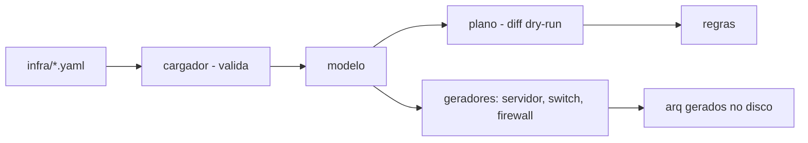

# infra-as-code-lab

[English](README.en.md) · **Português (Brasil)**

[](#) [](#) [](#) [](#.github/workflows/ci.yml) [](LICENSE)

## O que é

**Laboratório de Infraestrutura como Código (IaC)** que lê infraestrutura declarada em YAML (servidores, equipamentos de rede, acessos, firewall) e gera **planos e diffs determinísticos** de forma **idempotente** — inspirado no `plan`/`dry-run` do Terraform. Não aplica nada em equipamento real (é só simulação/geração de arquivos). É um laboratório educacional de IaC e idempotência.

## Status

Laboratório educacional de IaC, funcional e testado (121 testes).

## Funcionalidades

- **Modelo declarativo**: infraestrutura em YAML (`infra/servidores.yaml`, `rede.yaml`, `acessos.yaml`) com chaves normalizadas e validadas (`cargador.py`).
- **`plano`** (padrão): mostra o **diff** do que mudaria, sem escrever nada — por princípio `--dry-run`.
- **`gerar`**: escreve os arquivos gerados em disco (com opção de não escrever).
- **`regras`**: mostra regras/estados aplicados.
- **Idempotência**: mesmas entradas → mesmo plano; diff estável (data fixa para não quebrar o diff).
- **Geradores por tipo**: `servidor`, `switch`, `firewall`, além de `ap` e `base`.

## Arquitetura

Pacote `iaclab`: `cargador` (parse/validação de YAML), `modelo` (dados), `diff`/`plano` (comparação de estado), `geradores/*` (produzem saída), `render` e `cli`. Três estados base (desejado/atual/saída) garantem a idempotência.



## Stack

- Python ≥ 3.10
- PyYAML ≥ 6.0 (única dependência)
- pytest (dev)
- CI: GitHub Actions (windows-latest, Python 3.11)

## Estrutura do repositório

```
infra-as-code-lab/
├── pyproject.toml · requirements.txt
├── infra/
│   ├── servidores.yaml · rede.yaml · acessos.yaml
├── src/iaclab/
│   ├── cargador.py · modelo.py · diff.py · plano.py · render.py · cli.py
│   └── geradores/     # ap, base, firewall, servidor, switch
├── docs/              # modelo declarativo, por que dry-run importa
├── exemplos/          # plano de execução
├── tests/             # 121 testes
└── LICENSE            # MIT
```

## Pré-requisitos e instalação

Python ≥ 3.10.

```bash
pip install -e .
```

## Como executar

```bash
# mostra o diff do que mudaria, sem escrever nada (dry-run por padrão)
iaclab plano --infra infra/servidores.yaml --infra infra/rede.yaml --infra infra/acessos.yaml

# gera os arquivos em disco
iaclab gerar --infra infra/servidores.yaml --infra infra/rede.yaml --saida saida

# mostra as regras/estados
iaclab regras
```

## Testes e qualidade

Comando real (verificado pelo agente):

```bash
python -m pytest tests/
# 121 passed
```

- CI: `ci.yml` (windows-latest, Python 3.11) roda verificação de encoding, importa o pacote e executa pytest.

## Decisões técnicas e trade-offs

- **`plano`/`dry-run` como padrão**: nada é escrito sem decisão explícita, espelhando o `plan` do Terraform; o custo é um passo a mais para aplicar.
- **YAML declarativo com validação de chaves**: erro cedo em arquivos fora do contrato.
- **Data fixa na saída**: mantém o diff determinístico e comparável entre execuções.

## Limitações conhecidas e roadmap

- Não aplica em equipamentos reais (apenas simula/gera arquivos).
- O modelo cobre os tipos de gerador presentes (servidor, switch, firewall, ap); outros exigem novos geradores.

## Processo de desenvolvimento

Projeto individual de Kelvin Oliveira, construído com agentes de IA orquestrados e revisado pelo autor. O modelo declarativo, a idempotência e a revisão são do autor.

## Licença e autor

MIT — Copyright (c) 2026 Kelvin Rebelo de Oliveira.

**Autor**: [Kelvin Oliveira](https://github.com/KelvinOliveiraCode) · [Portfólio](https://kelvinoliveiracode.github.io/portfolio/)
